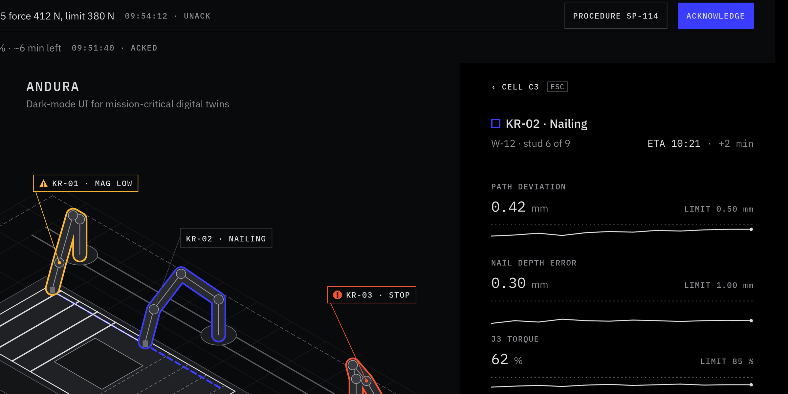
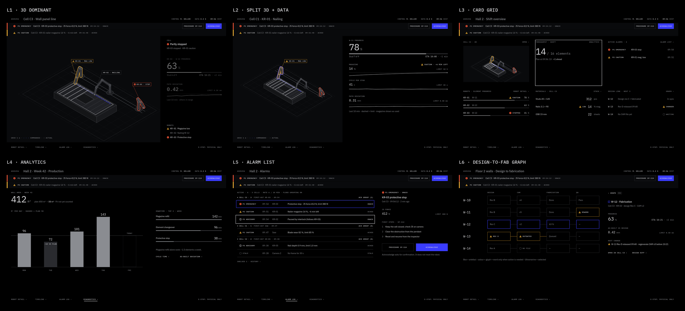

<p align="center"></p>

#  ANDURA

**A dark-mode design system and agent skill for mission-critical 3D digital-twin dashboards: grey when everything is normal, colour only for what needs attention.**

`version 0.6.0-draft` · tokens in W3C Design Tokens format · works on any platform · [MIT License](LICENSE)

## What you get
- **An agent skill** ([`SKILL.md`](SKILL.md)): hard rules, the 13 rules, colour, type, layout, workflow and checks for HMI, SCADA, robot-cell and BIM/digital-twin screens.
- **Design tokens** ([`tokens/andura.tokens.json`](tokens/andura.tokens.json)) exported to CSS, TypeScript, Python and C#.
- **Six worked screens**, one per layout pattern, each html + md spec, on desktop, tablet and phone, in alarm, normal, inspect and alarm-detail states plus data-quality states (stale, comms loss, robot offline, startup, alarm flood) and a sunlit-tablet mode (`?mode=sunlit`), up to 200 % text size: [L1 alarm](examples/l1-alarm.html), [L2 split](examples/l2-split.html), [L3 cards](examples/l3-cards.html), [L4 analytics](examples/l4-analytics.html), [L5 alarm list](examples/l5-alarms.html), [L6 design-to-fab](examples/l6-design-fab.html). Components follow [`references/recipes.md`](references/recipes.md).
- **Checks** that prove tokens, contrast, 56 px targets, clipping and fixed chrome.



## Install as an agent skill

One command, for Cursor, Claude Code, Codex, Copilot and [many more agents](https://github.com/vercel-labs/skills#supported-agents):

```bash
npx skills add lasaths/andura-skill        # this project
npx skills add lasaths/andura-skill -g     # all projects
```

Or copy this folder into your agent's skills directory (e.g. `~/.cursor/skills/andura` or `~/.claude/skills/andura`).

## Example prompt
```text
Use the andura skill to design an L1 screen for robot cell C3 in the alarm state, desktop and phone.
Review this dashboard against andura and list rule violations.
```
The agent loads `SKILL.md` (about 165 lines) and opens an example and `references/` only when it needs more depth.

## Tokens
`python3 scripts/export_tokens.py` writes [`tokens/build/`](tokens/build/) (`andura.css`, `andura-fonts.css`, `andura.ts`, `andura.py`, `Andura.cs`). Per-platform use: [`references/platforms.md`](references/platforms.md); component libraries: [`references/libraries.md`](references/libraries.md).

## Checks
```bash
python3 scripts/andura_check.py --all          # repo check + every example
python3 scripts/andura_check.py my-screen.html # your own page
```
The render checks need Chrome; CI ([`.github/workflows/check.yml`](.github/workflows/check.yml)) also compiles the TS and C# exports.

## Repository
```text
SKILL.md        the skill (agents read this first)
references/     depth, read on demand
tokens/         source of truth + generated exports
examples/       L1–L6 screens + specs, shared andura-ui.css/js
scripts/        export, checks (andura_check.py runs them all), hero render
evals/          fresh-agent eval: prompt, criteria, score.py
render/ assets/ hero renderer and rendered specimens
```

## References
[Layouts](references/layouts.md) · [Components](references/components.md) · [Recipes](references/recipes.md) · [Interaction](references/interaction.md) · [3D viewport](references/viewport.md) · [3D engines](references/3d-engines.md) · [Charts](references/charts.md) · [Motion](references/motion.md) · [Colour](references/colour.md) · [Typography](references/typography.md) · [Platforms](references/platforms.md) · [Libraries](references/libraries.md) · [Principles](references/principles.md) · [Research](references/research.md) · [Changelog](CHANGELOG.md)

## Status
**0.6.0-draft.** Rules, palette, type, layouts and components are locked; the skill as a whole is under review. All six layout patterns have a worked example. Wall screens don't follow OS text size, and 3D labels aren't checked at large text sizes. Changes are breaking if they touch a token or the rule numbering; see [`CHANGELOG.md`](CHANGELOG.md).

## License
[MIT](LICENSE) © 2026 Lassie (lasaths). IBM Plex is not bundled and stays under the SIL Open Font License 1.1.
