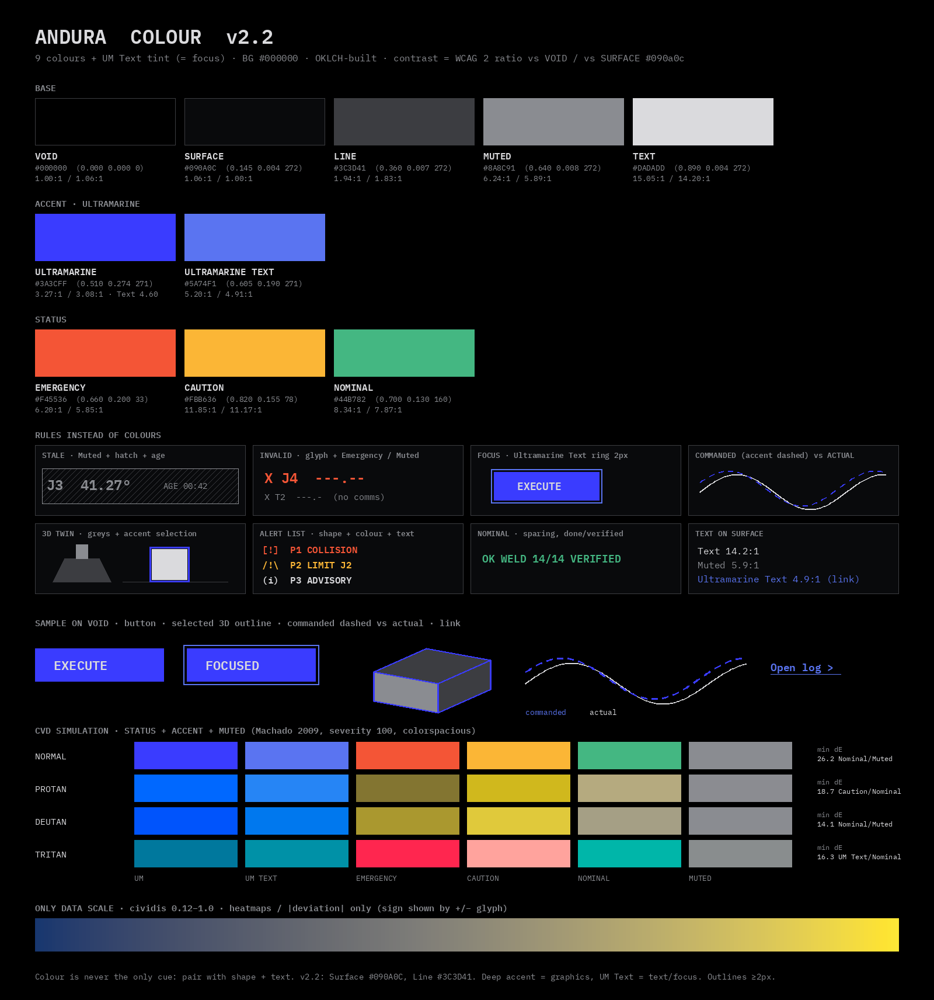
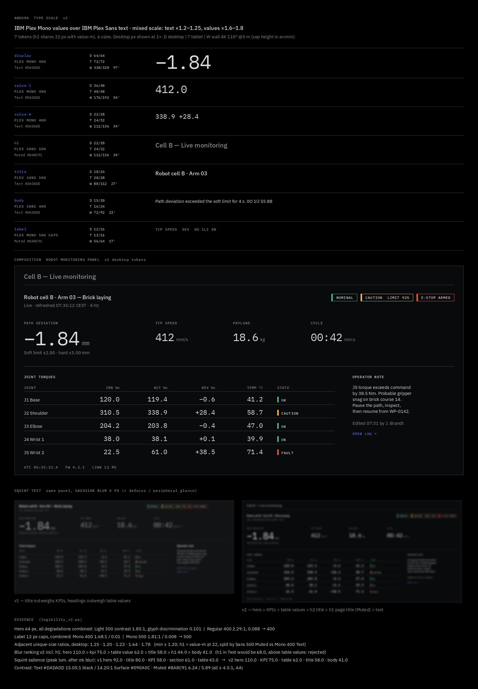
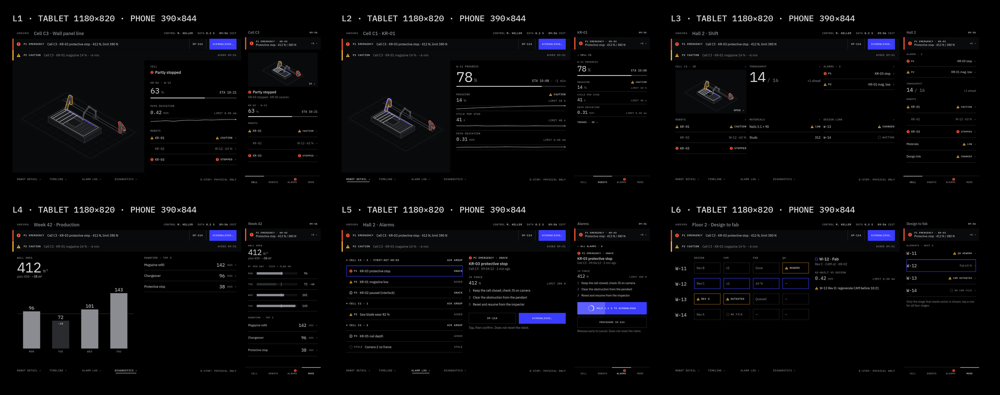
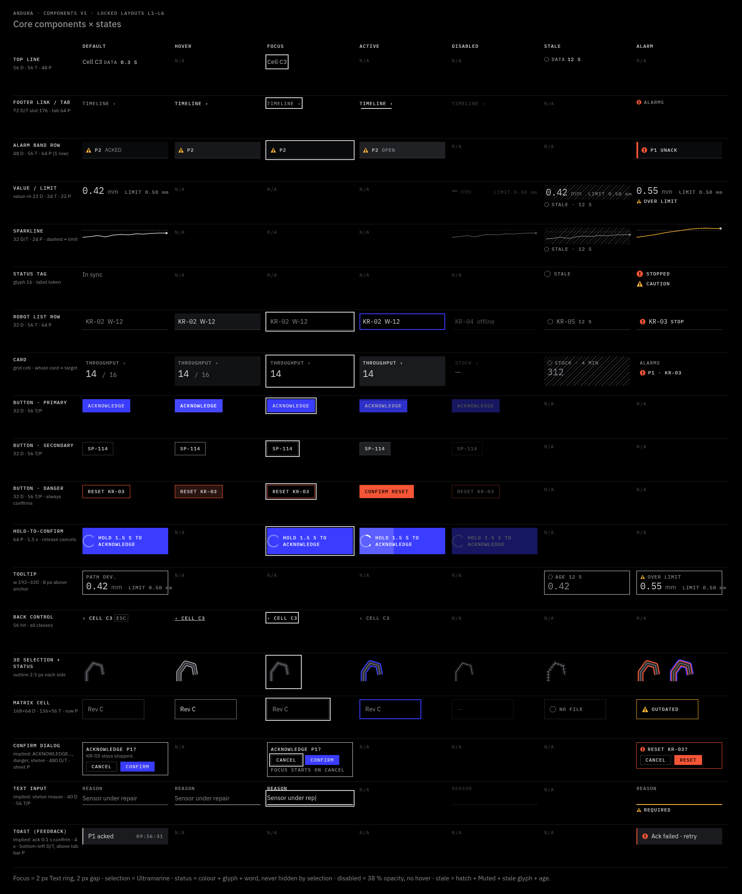
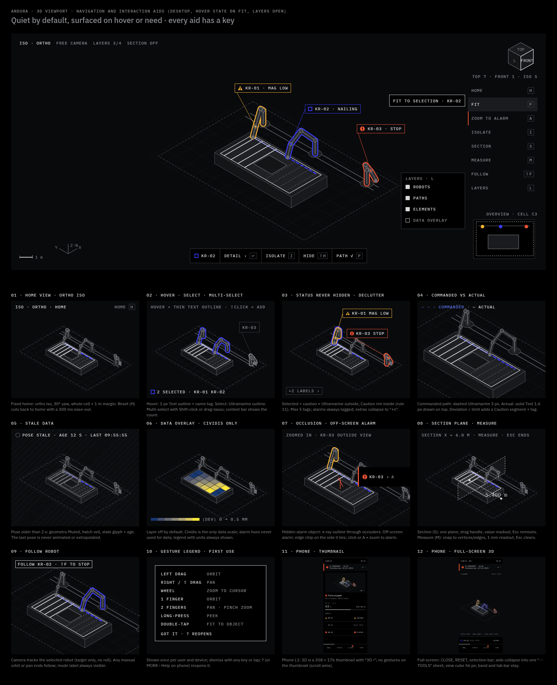
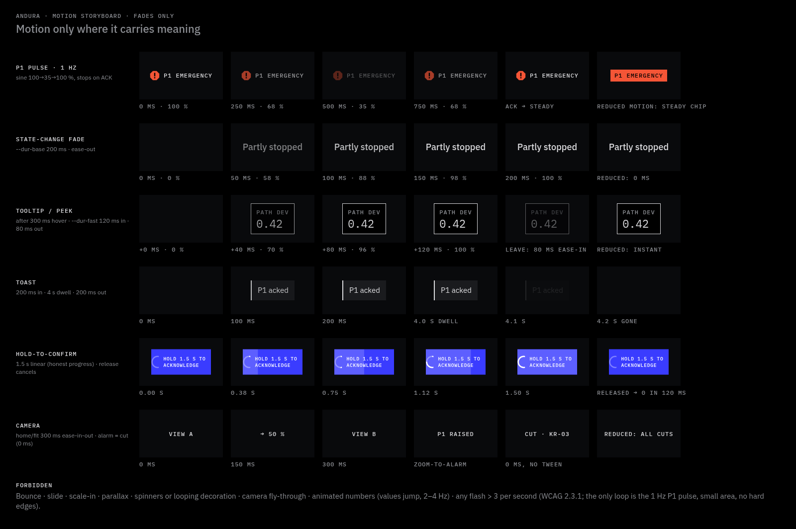

<p align="center"></p>

# ANDURA

**A dark-mode design system and agent skill for mission-critical 3D digital-twin dashboards.**

The UI is dark by default, grey when everything is normal, and colours only what needs attention.

`version 0.3.1-draft` · tokens in W3C Design Tokens format · works on any platform · [MIT License](LICENSE)

---

## Contents
- [What it is](#what-it-is)
- [Who it is for](#who-it-is-for)
- [The 13 rules](#the-13-rules)
- [Colour](#colour)
- [Type](#type)
- [Layouts](#layouts)
- [Components](#components)
- [3D viewport](#3d-viewport)
- [Motion](#motion)
- [Worked example](#worked-example)
- [Install as an agent skill](#install-as-an-agent-skill)
- [Use the tokens on any platform](#use-the-tokens-on-any-platform)
- [Verify](#verify)
- [Repository structure](#repository-structure)
- [Standards and sources](#standards-and-sources)
- [Fonts](#fonts)
- [Status and known limitations](#status-and-known-limitations)
- [Changelog](#changelog)
- [Contributing](#contributing)
- [License](#license)

## What it is
ANDURA is a human-factors design system for supervising construction robots. It ships as an agent skill (`SKILL.md`) with references, rendered specimens, design tokens and a verification script. An agent that loads the skill designs and reviews screens to these rules:
- answer one question per view;
- never hide an abnormal state;
- keep the screen calm until something needs the operator.

Its monochrome, type-led, subtract-first style follows the nothing-design skill; ANDURA adds alarms, live data and 3D for control-room use. Nothing else needs loading.

## Who it is for
Teams that build operator UI for:
- **Robotic construction:** live cell monitoring, robot state, path deviation, protective stops.
- **Digital-twin monitoring:** a 3D model of the cell with status, selection and occlusion handling.
- **Design-to-fabrication:** tracking which design changes have reached the robot.
- **Production analytics:** progress against plan, downtime, throughput.

Typical requests: HMI and SCADA screens, operator consoles, alarm screens, robot cell monitoring, BIM and digital-twin viewers. Not for consumer apps, light themes or marketing pages.

Target screens: desktop, tablet (gloves, 56 px targets), phone (alarm check and press-and-hold acknowledge), and a read-only control-room wall.

## The 13 rules
1. One question per view.
2. Grey when normal, colour when abnormal.
3. Hide normal, annunciate the exception.
4. Budget: at most 5 values and 1 display value per screen.
5. Show deviation against a limit, not raw readings.
6. Whitespace before lines, lines before boxes.
7. Label a value only when it is ambiguous.
8. Trends as sparklines with a dashed limit.
9. Progressive disclosure with obvious exits (peek, inspect, drill).
10. One fixed zone for always-on facts.
11. Never hide a status: not by selection, occlusion, off-screen position or LOD.
12. An alarm shifts the hierarchy, never the layout. The camera never moves on its own.
13. Motion means something: fades only, one loop (the P1 pulse).

`SKILL.md` adds 10 hard rules on top: every status has a colour, a glyph and a word; touch targets are 56 px minimum; navigation never sends a robot command; the E-stop is physical only. Sources and audits: [`references/principles.md`](references/principles.md).

## Colour
Palette v2.2. Pure black canvas, one raised layer, one accent hue, and alarm colours that appear only during an alarm.



| Token | Hex | Role | Contrast vs Void |
|---|---|---|---|
| Void | `#000000` | canvas | — |
| Surface | `#090A0C` | the only raised layer | 1.06 |
| Line | `#3C3D41` | hairlines, grid (never text) | 1.94 |
| Muted | `#8A8C91` | labels, units, stale values | 6.24 |
| Text | `#DADADD` | values, primary text, focus ring | 15.05 |
| Ultramarine | `#3A3CFF` | selection, commanded path, primary button | 3.27 |
| Ultramarine Text | `#5A74F1` | links and accent text only | 5.20 |
| Emergency | `#F45536` | P1 only | 6.20 |
| Caution | `#FBB636` | P2 only | 11.85 |
| Nominal | `#44B782` | explicit confirmation on detail levels only | 8.34 |

The data scale is cividis (7 stops), for magnitudes only. Focus is a 2 px Text ring with a 2 px gap, so it never looks like selection. Details: [`references/colour.md`](references/colour.md).

## Type
IBM Plex Sans for text, IBM Plex Mono for numbers, IDs and labels. Weights 400 and 500 only. Seven tokens, six sizes per screen class, every step at least ×1.2.



| Token | Font | Desktop | Tablet | Phone | Wall |
|---|---|---|---|---|---|
| display | Mono 400 | 64/64 | 72/72 | 40/44 | 320/320 |
| value-l | Mono 400 | 36/40 | 40/48 | 28/32 | 176/192 |
| value-m | Mono 400 | 22/28 | 24/32 | 22/28 | 112/136 |
| h1 | Sans 500, Muted | 22/28 | 24/32 | 18/24 | 112/136 |
| title | Sans 500 | 18/24 | 20/28 | 18/24 | 88/112 |
| body | Sans 400 | 15/20 | 16/24 | 15/20 | 72/92 |
| label | Mono 500 caps | 12/16 | 13/16 | 12/16 | 56/64 |

Wall sizes come from visual angle at 5 m. Details: [`references/typography.md`](references/typography.md).

## Layouts
Six locked patterns. Pick one by the question the view answers.

| Layout | Question |
|---|---|
| L1 3D dominant | Is the cell OK, and what is the robot doing? |
| L2 Split | How close is this robot to its limits? |
| L3 Card grid | Is the hall on plan, and where is the exception? |
| L4 Analytics | Is the week on plan, and what costs most? |
| L5 Alarm list | What needs me first? |
| L6 Design-to-fab | Which design changes haven't reached the robot? |


Breakpoints: phone below 600 px, tablet 600–1279, desktop from 1280, wall from 2560 viewed from 3 m or more. The top line, the alarm band and the footer stay pixel-identical across every state and layout.



Details: [`references/layouts.md`](references/layouts.md).

## Components
26 components, each with default, hover, focus, pressed, disabled, stale and alarm states and a size per screen class.



Details: [`references/components.md`](references/components.md).

## 3D viewport
Orthographic iso home view, grey model, no shadows. Selection is an Ultramarine outline. Status is a rim with a glyph and a word. Hidden alarmed objects show as an x-ray outline, and off-screen alarms as an edge chip. When the frame rate drops, status is the last thing to degrade.



Details: [`references/viewport.md`](references/viewport.md).

## Motion
Fades only, opacity only. Tokens are 0, 120, 200, 400 ms, plus camera 300 ms and hold 1500 ms. The only loop is the P1 pulse at 1 Hz, which stops on acknowledge. Never more than 3 flashes per second. With reduced motion, every fade is instant.



Details: [`references/motion.md`](references/motion.md).

## Worked example
[`examples/l1-alarm.html`](examples/l1-alarm.html) is a complete L1 screen in the alarm state, built only from `tokens/build/andura.css`. It has no hex values and works on desktop and tablet. Open it in a browser and add `?state=normal` to see the same cell with nothing active. [`examples/l1-alarm.md`](examples/l1-alarm.md) gives the coordinates, column widths, spacing, glyph sizes and edge-bar width. Agents start from it, and the touch and persistence checks run against it.

## Install as an agent skill
The skill is this folder. `SKILL.md` has the frontmatter (`name: andura`) that agent tools use to register it.

**Cursor:** copy the folder into a skills directory, either for the project or for your user.
```bash
# project skill
mkdir -p .cursor/skills && cp -R andura .cursor/skills/andura
# or user-wide
mkdir -p ~/.cursor/skills && cp -R andura ~/.cursor/skills/andura
```

**Claude-style skills folder:**
```bash
mkdir -p ~/.claude/skills && cp -R andura ~/.claude/skills/andura
# or per project: .claude/skills/andura
```

**Invoke** by name, or describe the task and let the agent match the description:
```text
Use the andura skill to design an L1 screen for robot cell C3 in the alarm state, desktop and phone.
Review this dashboard against andura and list rule violations.
```
The agent loads `SKILL.md` (about 150 lines: hard rules, the 13 rules, colour, type, chrome sizes, workflow, checks). It opens the example and the files in `references/` only when it needs more depth.

## Use the tokens on any platform
[`tokens/andura.tokens.json`](tokens/andura.tokens.json) is the single source of truth. It covers colour, type, spacing, sizes, breakpoints and motion. Units are px (device-independent: CSS px, dp, pt, WPF DIP) and ms. Never edit the generated files. Change the JSON and regenerate:

```bash
python3 scripts/export_tokens.py
# 231 tokens -> tokens/build/andura.css, andura.ts, andura.py, Andura.cs
```

**CSS**
```css
@import "tokens/build/andura.css";
.value { color: var(--andura-color-text); font-size: var(--andura-type-value-m-desktop-fontSize); }
.panel { background: var(--andura-color-surface); }
```

**TypeScript**
```ts
import { andura } from "./tokens/build/andura";
const selection = andura["color-ultramarine"];   // "#3A3CFF"
const fade = andura["motion-duration-base"];     // 200 (ms)
```

**Python**
```python
from andura import ANDURA          # tokens/build/andura.py
ANDURA["color-emergency"]          # "#F45536"
ANDURA["size-touch-min"]           # 56 (px)
```

**C# / WPF**
```csharp
var text = (Color)ColorConverter.ConvertFromString(Andura.ColorText);   // #DADADD
double touch = Andura.SizeTouchMin;                                      // 56 DIP
```

**Unity / Three.js:** read the JSON or the TS export. Draw the HUD in screen space, and set outline widths in screen px so the 2.5 px selection outline stays 2.5 px at any zoom. The rules that must hold on every platform are in [`references/platforms.md`](references/platforms.md).

## Verify
```bash
python3 scripts/check.py          # tokens, contrast, references, banned values, versions (+ self-test)
python3 scripts/touch_check.py    # example, 3 classes × 3 states × 4 text scales: 56 px targets, no overlap or clipping, text >= 12 px (+ self-test)
python3 scripts/persist_check.py  # example: top line and footer pixel-identical, normal vs alarm and inspect, 3 classes (+ self-test)
```
Each script exits 0 only if every check passes. `check.py` checks:
- that the hexes, type sizes, breakpoints and chrome sizes in `SKILL.md` match the tokens;
- every contrast figure, recomputed with the WCAG formula from the token hexes;
- the reference tables, the motion tokens, `assets/pal-v2.2.json` and the four exports;
- that no file uses a hex that is not a token, or a banned or superseded value (thin weights, weight-600 Sans, old surface hexes, the Greek delta, old 40 px chrome);
- that the example uses only `var(--andura-*)` colours that exist;
- that `SKILL.md`, the tokens and `CHANGELOG.md` carry the same version.

The two render checks need Chrome and Pillow. Set `CHROME` to use another binary.

**CI.** [`.github/workflows/check.yml`](.github/workflows/check.yml) runs on every push and pull request. It runs all three checks, regenerates the exports and fails on any diff, compiles `andura.ts` with `tsc --noEmit --strict`, and builds `Andura.cs` with `dotnet build` (warnings count as errors).

## Repository structure
```text
andura/
├── SKILL.md                    agent skill: hard rules, 13 rules, colour, type, chrome, workflow, checks
├── README.md  CHANGELOG.md  .gitignore
├── .github/workflows/check.yml CI: checks, export diff, tsc, dotnet build
├── tokens/
│   ├── andura.tokens.json      single source of truth (W3C Design Tokens), carries the version
│   └── build/                  generated: andura.css, andura.ts, andura.py, Andura.cs
├── examples/
│   ├── l1-alarm.html           worked L1 screen, tokens only (desktop + tablet, ?state=normal|alarm)
│   └── l1-alarm.md             annotated spec: coordinates, widths, spacing, glyphs, edge bar
├── scripts/
│   ├── check.py                tokens, contrast, references, bans, versions, self-test
│   ├── touch_check.py          56 px / overlap / 12 px check on the example
│   ├── persist_check.py        top line + footer pixel check on the example
│   ├── export_tokens.py        JSON -> CSS, TS, Python, C#
│   ├── render_hero.py          renders assets/hero.png (downloads IBM Plex on first run)
│   └── _chrome.py              shared headless-Chrome helpers
├── render/                     vendored renderer for the hero (palette read from the tokens)
├── references/                 depth for the agent, read on demand
│   ├── layouts.md  components.md  interaction.md  viewport.md  motion.md
│   ├── colour.md  typography.md  platforms.md
│   └── principles.md  research.md
└── assets/                     hero.png, swatch-v2.2.png, type-scale-v2.png, sheet-min.png,
                                responsive-sheet.png, components.png, viewport.png, motion.png, pal-v2.2.json
```

## Standards and sources
ANDURA follows these standards. Full citations are in [`references/research.md`](references/research.md) and [`references/principles.md`](references/principles.md).
- **ANSI/ISA-101.01:** high-performance HMI. Grey normal, display hierarchy L1–L4.
- **ANSI/ISA-18.2:** alarm management. Priorities, acknowledgement, flood handling.
- **NASA-STD-3001 Vol. 2 and the NASA Human Integration Design Handbook:** crew interfaces, alert colours, legibility.
- **MIL-STD-1472:** character size by visual angle, colour coding.
- **FAA AC 25-11B:** red/amber alerting, colour never the only cue.
- **ISO 9241-303 and ANSI/HFES 100:** display ergonomics.
- **ISO 10218:** robot safety; the E-stop stays physical.
- **WCAG 2.2:** contrast 1.4.3 and 1.4.11, focus 2.4.11 and 2.4.13, flashes 2.3.1, reduced motion.
- **ASM Consortium, SFTE display guidelines, Tufte, NN/g:** grey backgrounds, command vs actual, data-ink, 5-second test.
- **Colour science:** OKLCH (Ottosson), cividis (Nuñez et al. 2018), CVD simulation (Machado et al. 2009).

Some clause numbers are marked "[verify]" in the references. Check them against the primary standards before you rely on them.

## Fonts
[IBM Plex](https://github.com/IBM/plex) Sans and Mono, licensed under the SIL Open Font License 1.1. The fonts are not bundled. Install them from the IBM Plex repository or [Google Fonts](https://fonts.google.com/?query=IBM+Plex), and embed them in your app. `scripts/render_hero.py` downloads them into `render/fonts/` (ignored by git). Use weights 400 and 500 only.

## Status and known limitations
**0.3.1-draft.** The rules, palette, type, layouts and components are locked. The skill as a whole is still under review.
- **OS text scaling** (WCAG 1.4.4) is specified up to 200 % and checked on the example. The wall class is excluded (sizes come from visual angle), and 3D tags are not checked at scale.
- **The example covers desktop, tablet and phone** in the alarm, normal and inspect states. Other layouts (L2–L6) are specified but not built.
- **The render checks need Chrome.** `render_hero.py` also downloads IBM Plex from the Google Fonts repository on first run.
- **Fixed since 0.2:** the TS and C# exports now compile (checked locally and in CI); the 3D greys are tokens (`color.3d.*`); the hero shows the alarm band.

## Changelog
See [`CHANGELOG.md`](CHANGELOG.md). Any change to a token value or name, or to the rule numbering, is a breaking change.

## Contributing
1. Change values in `tokens/andura.tokens.json` only. Then run `python3 scripts/export_tokens.py`. Bump the version in the tokens, `SKILL.md` and `CHANGELOG.md` together.
2. Keep `SKILL.md` and `references/` in step with the tokens. Write rules as commands, with px and ms.
3. Run the three checks in [Verify](#verify) and fix every failure before you open a pull request. CI runs them too.
4. When you add a rule, add a check or a self-test case for it where it can be checked by machine.
5. Re-render any affected image in `assets/` and say in the pull request which images changed.

## License
[MIT](LICENSE) © 2026 Lassie (lasaths). This covers the skill, docs, tokens, scripts, examples and images. IBM Plex is not bundled and stays under the SIL Open Font License 1.1.
